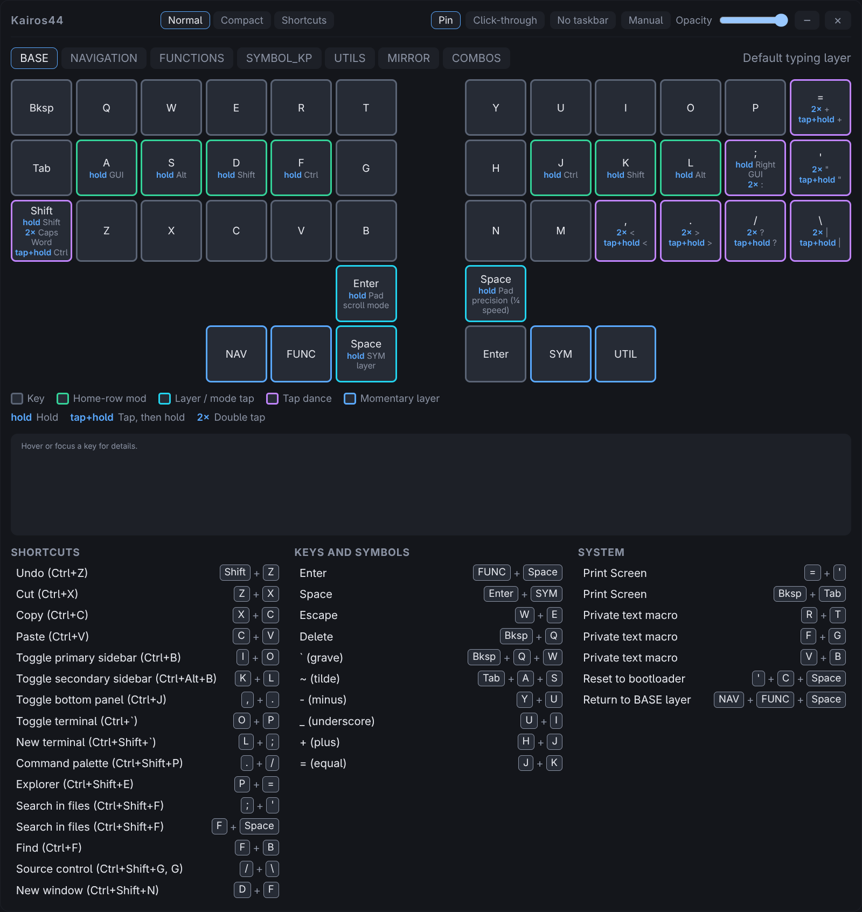

# Kairos44 Companion

Kairos44 Companion is a small desktop window that shows your Kairos44 keyboard:
every key on the selected layer, what each key does when tapped, held or
tapped repeatedly, and the key combinations you can press together. It is meant
to float above your other windows so you can look up a shortcut without leaving
what you are doing.

It is built with Tauri 2, SolidJS and Vite. It runs on Linux today, and is
developed and tested on Hyprland (Omarchy).

## What it does

- Draws all 44 key positions of the Kairos44 for each of the seven layers.
- Colours each key's border by what kind of key it is, and writes out its hold,
  double tap and tap-then-hold actions.
- Lists every combo for the layer with the keys to press, and highlights those
  keys when you point at a combo.
- Has three views: Normal, Compact and Shortcuts.
- Can be pinned above other windows, made translucent, and made click-through.
- Can be shown, hidden and switched between views from the keyboard.
- Contains this manual, so you can read it without leaving the app.

## Quick start

1. Build it: `npm run build:bin` in the `companion` folder
   ([Install and run](install.md)).
2. Start `src-tauri/target/release/kairos44-companion`.
3. Pick a layer with the tabs along the top, and a view with the buttons in the
   title bar.
4. Bind the show/hide key ([Key bindings](keybindings.md)) so you can bring the
   window up while your hands stay on the keyboard.
5. Press `F1` or the Manual button at any time to open this manual.

## Where to read next

| Page                                      | What it covers                                             |
| ----------------------------------------- | ---------------------------------------------------------- |
| [Install and run](install.md)             | Requirements, building, running, where settings are stored |
| [The three views](views.md)               | Normal, Compact and Shortcuts                              |
| [Reading a key](reading-keys.md)          | Key types, colours, gestures, details, the layers          |
| [Window controls](window-controls.md)     | Pin, opacity, click-through, taskbar, sizes                |
| [Live layer sync](live-sync.md)           | Following the keyboard's layer, what the status strip shows |
| [Command line](command-line.md)           | Controlling a running window from a script or key          |
| [Key bindings](keybindings.md)            | The key combos that show, hide and switch the window       |
| [Hyprland](hyprland.md)                   | How pinning, hiding and sizing work on Hyprland            |
| [Layer and combo reference](reference.md) | Every layer and every combo, generated from the app's data |
| [Troubleshooting](troubleshooting.md)     | Common problems and fixes                                  |
| [Development](development.md)             | Code layout, data model, tests, extending the app          |
| [Roadmap](roadmap.md)                     | What is done and what is planned                           |

## Current limits

- The window follows the layer your keyboard is on while the keyboard is
  connected by USB and the updated firmware is installed; otherwise you choose
  the layer yourself ([Live layer sync](live-sync.md)). Bluetooth-only use
  cannot be followed.
- The key data is written by hand from the keymap for the trackpad build of the
  Kairos44 (the NAVIGATION layer with mouse and scroll keys). The keyboard-only
  variant of that layer is not drawn.
- Only Linux on Hyprland has been tested. Windows and macOS are untested.
