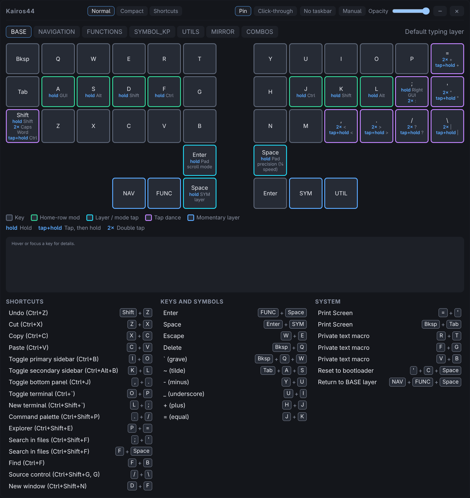
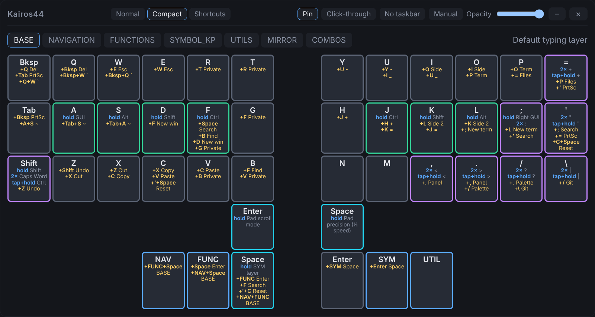
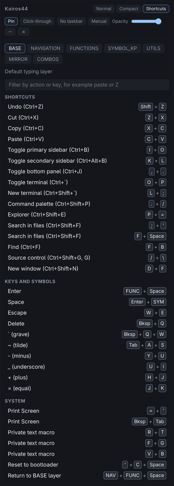
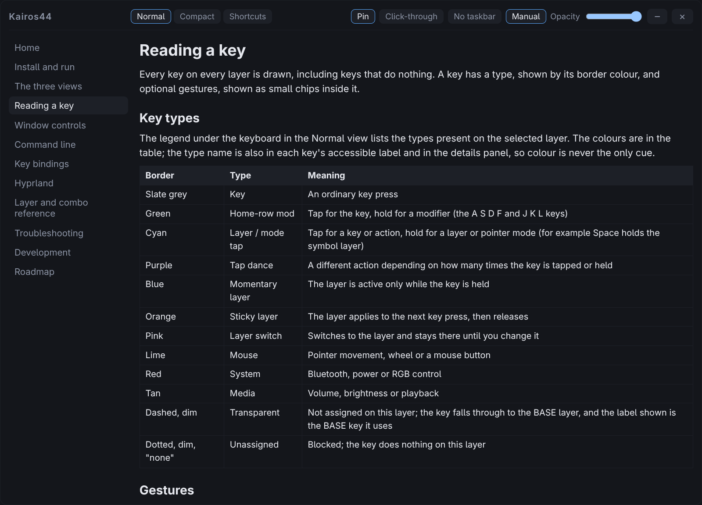

# The three views

The view buttons in the title bar switch between three layouts of the same
information. Each view remembers its own window size, Pin state and Opacity
([Window controls](window-controls.md)), so you can have a large reference
window and a small always-on-top one and move between them with one key.

The layer tabs along the top are shared by all views, and the line beside them
says how to reach the selected layer on the keyboard.

## Normal

The full view, 1000 by 780 by default.

- The keyboard, with each key coloured by type and its gestures written out.
- A legend that lists only the key types and gestures used on this layer.
- A details panel. Point at, or Tab to, any key to see its type, what a tap
  does, every gesture, and the combos it belongs to.
- The combo list for the layer, grouped into Shortcuts, Keys and symbols, and
  System. Each entry shows the keys to press, for example `Z` + `X` for Cut.
  Pointing at an entry highlights those keys on the keyboard.

## Compact

The keyboard alone, 1000 by 620 by default, with no legend, details panel or
list. To make up for that, each key carries more information:

- Its label, then its gestures: for example `hold GUI` under `A`.
- In gold, every combo it takes part in, written as the other keys to press and
  a short name. On `Z` you see `+Shift Undo` and `+X Cut`: press Z together with
  Shift for Undo, or with X for Cut.
- Hovering a key shows a tooltip that spells out the same facts in full.

The gesture codes and combo names are listed in
[Reading a key](reading-keys.md).

## Shortcuts

A narrow window, 460 by 760 by default, that shows only the combo list with the
keys to press and no keyboard drawing. It suits a small always-on-top window
beside your editor.

The filter box narrows the list. Type any part of an action or a key name.
Several words must all match, so `z x` finds the combo on those two keys and
`paste` finds Paste. The filter applies to the selected layer.

## Switching views

| How                                       | Effect                                                       |
| ----------------------------------------- | ------------------------------------------------------------ |
| The Normal, Compact and Shortcuts buttons | Select a view                                                |
| `kairos44-companion --view compact`       | Select a view by name from a script or key                   |
| `kairos44-companion --next-view`          | Cycle Normal, Compact, Shortcuts                             |
| `SUPER + SHIFT + L`                       | The bound key for next view ([Key bindings](keybindings.md)) |

Switching resizes the window to the size that view last had, and applies that
view's Pin state.

## The manual

The Manual button in the title bar, the `F1` key and
`kairos44-companion --manual` open this manual in place of the current view.
Press them again, or Esc, to return to where you were.
